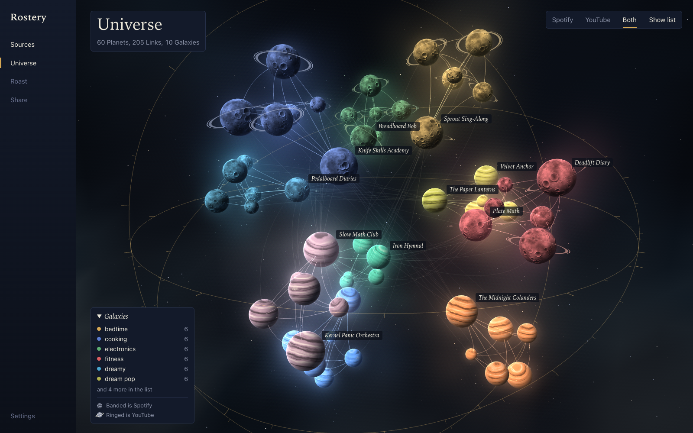
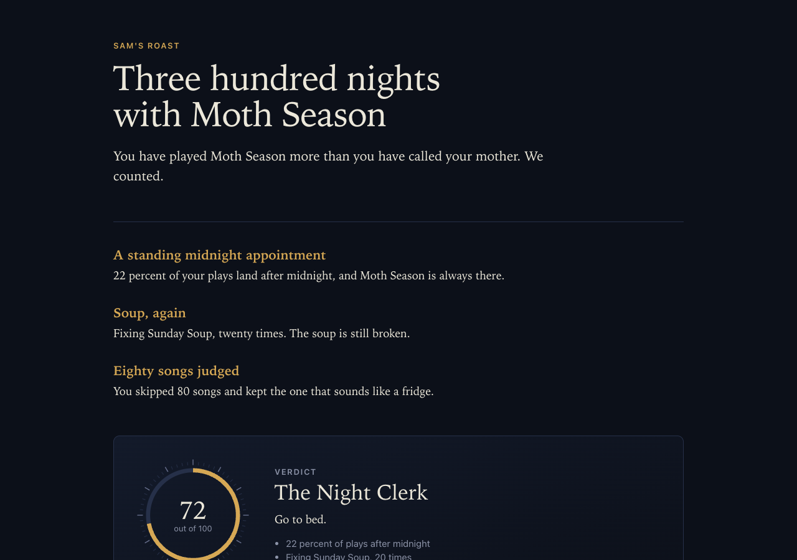
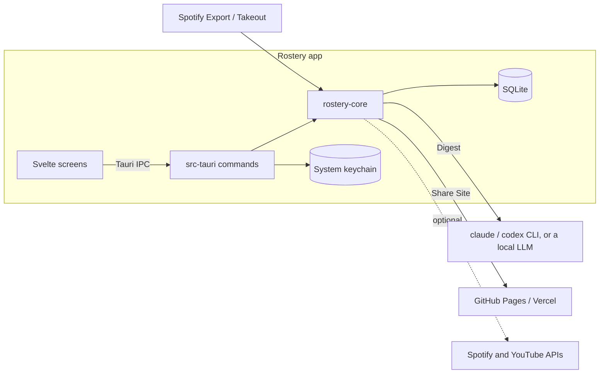

# Rostery

Get roasted by an AI that read your Spotify and YouTube history. Rostery runs on your own computer, turns your taste into a universe of planets, and gives you a page you can share.





## What it does

- **Reads your history.** Drop in a Spotify Export or a Google Takeout. Rostery stores it in a local database.
- **Draws your Universe.** Every artist and channel is a Planet, sized by how long you spent with it. Planets you play together, or that share an Interest, are joined, and they fall into Galaxies with names.
- **Roasts you.** An AI reads a short Digest of your history and writes a headline, a handful of Burns and a Verdict. It runs through the Claude Code or Codex subscription you already pay for, or a local model in Ollama or LM Studio.
- **Shares it.** Rostery builds a small web page of your Roast and Universe, and can publish it to GitHub Pages or Vercel with your own account.

## Where your data goes

Rostery has no server. Your history, Roasts and settings stay in a database on your computer, and tokens stay in your system keychain.

"Local" has limits, and Rostery says so on screen before anything leaves:

- With **Claude Code or Codex**, a Digest of your history goes to Anthropic or OpenAI. It holds song and video titles, artist and channel names, and dates. Settings has a button that shows the exact Digest first.
- With **Ollama or LM Studio** on this computer, nothing leaves, unless you pick an Ollama cloud model.
- **Publishing** makes your Share Site public. You choose what goes on it.

[PRIVACY.md](PRIVACY.md) lists every case, and how to disconnect and delete everything.

## Install

Download the latest build from [Releases](https://github.com/0PrashantYadav0/rostery/releases):

- **macOS:** open the `.dmg` and drag Rostery to Applications. The build is not notarized yet, so the first time, right-click Rostery and choose Open.
- **Debian and Ubuntu:** `sudo apt install ./Rostery_*.deb`
- **Other Linux:** make the `.AppImage` executable and run it.

On Linux, Rostery keeps tokens in a Secret Service such as GNOME Keyring or KWallet, which most desktops already run.

## Get your history

**Spotify.** In Spotify, open Account, Privacy settings, Download your data, and request **Extended streaming history**. It holds your whole listening life, where the regular account data covers about a year. Spotify emails a link, which can take up to 30 days. Drop the zip into Rostery.

**YouTube.** At [takeout.google.com](https://takeout.google.com), choose Deselect all, tick **YouTube and YouTube Music**, then under Multiple formats set history to **JSON**. Takeout gives HTML unless you change it, and Rostery cannot read HTML. Drop the zip into Rostery. YouTube's API has no watch history, so Takeout is the only way to get it.

Not ready yet? The Sources screen has demo data, so you can look around first.

## Choose who writes your Roast

| Provider | Setup |
|---|---|
| Claude Code | Install Claude Code and run `claude` once to sign in. |
| Codex | Install Codex and run `codex login`. |
| Ollama | Install Ollama, pull a model, and raise its context, for example `OLLAMA_CONTEXT_LENGTH=32768 ollama serve`. Rostery says so if a prompt gets cut. |
| LM Studio | Load a model and start the local server. |

Settings shows which ones are ready, with a hint for any that is not.

## Share

The Share screen builds the page from your choices. Song and video titles are off unless you tick them. Your Roast is on, and the screen warns that it may quote titles and names from all your history. Export, preview it in your browser, then publish:

- **GitHub Pages:** connects with one click if the `gh` command is signed in, or with a token that has the `public_repo` scope. Rostery only ever writes to a repo it created.
- **Vercel:** connects with a token from your Vercel account.

## Connections are optional

Rostery can connect to Spotify and YouTube with an app you register yourself. They add a little: your last 50 Spotify plays, your top artists and their genres, and your YouTube subscriptions, likes and channel topics. An Export holds far more.

Read this before you connect Spotify. Spotify's Developer Policy forbids analysing Spotify Content into new listening metrics, and ingesting it into an AI model. A Universe and a Roast do both. Rostery quotes those clauses and will not connect until you agree, and the app you register is your own, so you accept Spotify's terms yourself. [ADR 0002](docs/adr/0002-exports-are-the-primary-history.md) explains the choice.

## How it is built



- `crates/core` holds all the logic: import, the Universe, the Digest, Providers, the Share Site, publishing and Connections. It has no UI and no keychain.
- `src-tauri` is the Tauri 2 shell: commands, the keychain and the file picker.
- `web/app` is the app's Svelte UI, `web/share` the Share Site, and `web/universe` the three.js view both of them use.

The words used throughout are in [GLOSSARY.md](GLOSSARY.md), the design is in [docs/design.md](docs/design.md), and decisions are in [docs/adr](docs/adr).

## Develop

You need Rust stable, Node 22 or newer and pnpm 9. On Linux, also install `libwebkit2gtk-4.1-dev libsecret-1-dev libdbus-1-dev libayatana-appindicator3-dev librsvg2-dev patchelf`.

```sh
pnpm install
pnpm tauri dev          # run the app
pnpm build              # the app and the Share Site, which cargo needs
cargo test --workspace  # Rust tests
pnpm test               # unit tests
pnpm test:e2e           # Playwright, in Chromium and WebKit
pnpm tauri build        # .dmg on macOS, .deb and .AppImage on Linux
```

Tests that talk to the real `claude` and `codex` are ignored by default, since they use your subscription: `cargo test -p rostery-core -- --ignored live_`.

See [CONTRIBUTING.md](CONTRIBUTING.md) before you open a pull request.

## License

[MIT](LICENSE)
